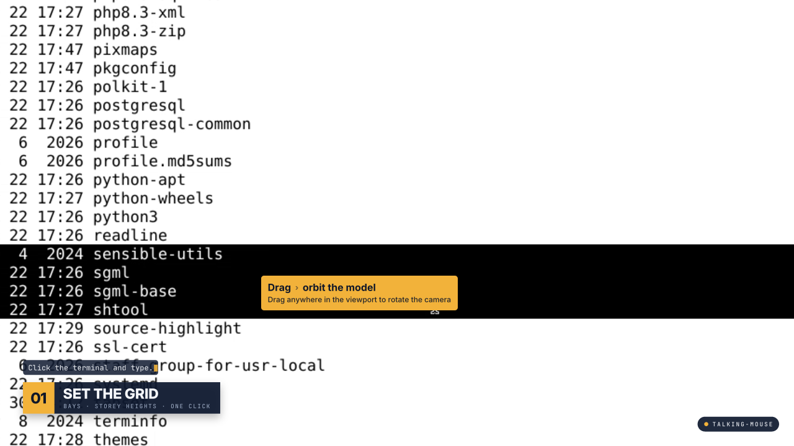
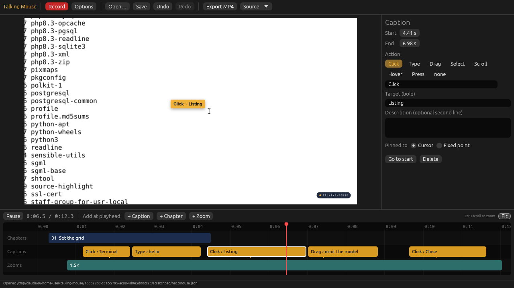

# talking-mouse

A screen recorder and video editor, written in Rust, that pins **callout captions to your mouse cursor**. Use it for product tours where the pointer explains itself: "Click › Regenerate grid model".



While you record, Talking Mouse tracks your pointer, clicks and typing. When you stop, it drafts a caption for every click, drag and typing burst. In the editor you fill in what each one points at, then export an MP4 with:

- **Cursor callouts.** An amber box with `Action › Target` in bold and an optional description line. It trails the pointer with a little lag, pops in and fades out, and flips sides near the edges of the frame.
- **Chapter cards.** A numbered lower-third (`01  SET THE GRID`) with a monospace subtitle. An optional line of narration types itself out above the card.
- **Smooth zooms.** The camera eases in and follows the cursor, then eases back out.
- **Click ripples** and a **watermark** pill.



## Install

Download the installer for your system from the [Releases](https://github.com/BitLess246/talking-mouse/releases) page.

| System | File | Notes |
| --- | --- | --- |
| **Windows 10/11** | `TalkingMouse-<version>-windows-x64-setup.exe` | Includes ffmpeg. Installs without admin rights and adds a Start menu entry. Optionally adds a desktop shortcut and puts the `talking-mouse` CLI on your PATH. A `…-portable.zip` is also available. |
| **macOS 11+** (Apple Silicon and Intel) | `TalkingMouse-<version>-macos-universal.dmg` | Drag the app to Applications, then run `brew install ffmpeg`. |
| **Debian / Ubuntu** | `talking-mouse_<version>_amd64.deb` | `sudo apt install ./talking-mouse_*.deb` also installs ffmpeg. |
| **Other Linux** | `talking-mouse-<version>-linux-x86_64.tar.gz` | Extract it, run `./install.sh` (installs to `~/.local`), and install ffmpeg with your package manager. Run `./install.sh --uninstall` to remove it. |

The installers aren't code-signed yet, so the first launch needs an extra step:
- **Windows SmartScreen:** click *More info → Run anyway*.
- **macOS Gatekeeper:** right-click the app → *Open*. If macOS still refuses, run `xattr -dr com.apple.quarantine "/Applications/Talking Mouse.app"`.

On macOS, recording needs two permissions in *System Settings → Privacy & Security*: **Screen Recording**, and **Input Monitoring** for keystroke timing.

### Publishing a release

The [Build installers](.github/workflows/release.yml) workflow builds every installer on each push and pull request; they are available as workflow artifacts. To publish them, push a version tag:

```sh
git tag v0.1.0 && git push origin v0.1.0
```

The workflow then attaches all installers to a GitHub release for that tag.

## Build from source

- **Rust** 1.95 or newer (required by egui 0.37).
- **ffmpeg** and **ffprobe**, used for screen capture, decoding and H.264 encoding. The app looks for them in this order: `$TALKING_MOUSE_FFMPEG_DIR`, next to its own executable, Homebrew's `bin` folders on macOS, and then your `PATH`.
- Linux only: X11 (or XWayland). Building needs the libX11 development headers, which the `device_query` crate uses for global mouse tracking (`sudo apt install libx11-dev libxkbcommon-x11-0`). On pure Wayland, record with your compositor's tool and import the video (see below).

```sh
cargo build --release
./target/release/talking-mouse-editor     # the editor, as a windowed app
./target/release/talking-mouse --help     # the command line (`talking-mouse` alone also opens the editor)
```

Headless build without the GUI: `cargo build --release --no-default-features --features capture`.

To build an installer locally:
- `.deb`: `cargo deb`
- macOS `.dmg`: `packaging/macos/build-dmg.sh <version>`
- Windows setup: `packaging/windows/talking-mouse.iss`, built with [Inno Setup](https://jrsoftware.org/isinfo.php)

The workflow file shows the exact steps for each.

## Workflow

### 1. Record

Press **Record** in the editor, or use the CLI:

```sh
talking-mouse record -o demo.mkv --auto-zoom 1.6
#   --fps 30            capture rate
#   --region x,y,w,h    capture part of the screen
#   --audio             also record the default microphone
#   --input ...         override the ffmpeg input (":1.0", "2:none", "desktop", …)
```

To stop, press **Enter**, **Ctrl+C**, or the global hotkey **Ctrl+Shift+F9**, which works from any app. This writes `demo.mkv` and `demo.tmouse.json`, which holds the cursor track, the clicks and the drafted captions.

Talking Mouse stores *when* keys are pressed, never *which* keys. Typing a password while recording doesn't leak it into the project file.

### 2. Edit

```sh
talking-mouse edit demo.tmouse.json
```

- Click a bar in the timeline to select it and edit it in the inspector. Drag a bar to move it, or drag its edges to trim it.
- Drafted captions without text show as dim bars marked `…`. Fill in **Target** (bold) and optionally **Description**.
- Use **+ Caption / + Chapter / + Zoom** to add an item at the playhead.
- Each caption or zoom can follow the **Cursor** or sit at a **Fixed point**. Click **Pick on preview** to set the point.
- In the **Project** panel (shown when nothing is selected), you set the colours, the watermark text, the overlay size, how far captions lag behind the pointer, and the cursor sync offset and scale.
- Shortcuts: `Space` play/pause, `←/→` step one frame (`Shift` steps 1 s), `Delete` removes the selected item, `Ctrl+Z` / `Ctrl+Shift+Z` undo and redo, `Ctrl+S` saves.

### 3. Export

Click **Export MP4** in the editor, or run:

```sh
talking-mouse render demo.tmouse.json -o demo.mp4 --height 1080
talking-mouse still  demo.tmouse.json --at 12.5 -o frame.png   # single frame
```

Compositing runs on every CPU core, and the export keeps the recording's audio.

### Existing videos

```sh
talking-mouse new walkthrough.mp4    # creates walkthrough.tmouse.json
```

An imported video has no cursor track, so its captions sit at fixed points. Use **Pick on preview** to place them.

## Troubleshooting

- **Callouts lead or trail the pointer.** Adjust **Sync offset** in the Project panel. Recordings measure the offset automatically, but every capture backend has some startup latency.
- **Callouts sit at half the pointer position (Retina/HiDPI).** Set **Scale** to 2.0.
- **macOS: the wrong screen is captured.** List the devices with `ffmpeg -f avfoundation -list_devices true -i ""`, then pass `--input "<index>:none"`. Grant Screen Recording and Accessibility permissions to your terminal.

## Project file

`*.tmouse.json` is plain JSON, so you can generate or edit it with scripts:

```json
{
  "source": "demo.mkv", "width": 1920, "height": 1080, "fps": 30.0, "duration": 42.0,
  "cursor": [{ "t": 0.0, "x": 640, "y": 360 }],
  "clicks": [{ "t": 2.1, "x": 812, "y": 455 }],
  "captions": [{
    "start": 1.4, "end": 3.4, "action": "Click", "target": "Regenerate grid model",
    "description": "", "anchor": { "kind": "cursor" }
  }],
  "chapters": [{ "start": 0.5, "end": 9.0, "title": "Set the grid",
                 "subtitle": "Bays · storey heights · one click",
                 "narration": "Set the grid and hit “Regenerate grid model”." }],
  "zooms": [{ "start": 1.0, "end": 4.0, "scale": 1.6, "focus": { "kind": "cursor" } }],
  "style": { "watermark": "yourapp.com" }
}
```

## Code layout

| Module | Role |
| --- | --- |
| `src/record.rs` | ffmpeg screen grab, plus a 120 Hz input tracker (`device_query`) |
| `src/auto.rs` | drafts captions from clicks, drags and typing bursts, and zooms from captions |
| `src/overlay.rs` | renders a frame from the camera, callouts, chapter card, ripples and watermark (`tiny-skia`) |
| `src/text.rs` | text layout and rasterisation (`ab_glyph`, with bundled Inter and JetBrains Mono) |
| `src/render.rs` | parallel decode → composite → encode export |
| `src/editor/` | egui editor: preview worker, timeline, inspector |
| `src/bin/talking-mouse-editor.rs` | windowed launcher for the editor (no console window on Windows) |
| `packaging/` | installer scripts for Windows (Inno Setup), macOS (`.app`/`.dmg`) and Linux (`.deb`, `install.sh`); `make-icons.py` regenerates the icons |

Each overlay is a pure function of time, so scrubbing in the editor shows exactly what the export will contain.

## License

MIT for the code. The bundled fonts (Inter and JetBrains Mono) are under the SIL Open Font License; see `assets/fonts/OFL.txt`.
